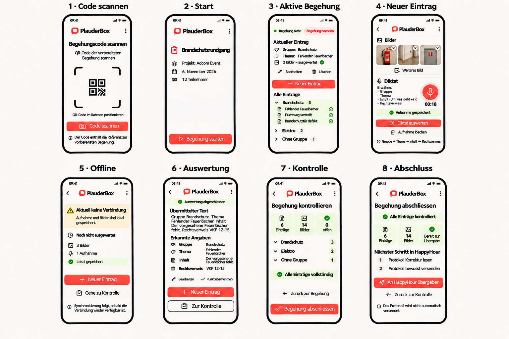

# D009 – Designentwurf für die mobile Begehungsführung

## Zweck

Dieser Designentwurf hält die am 10.11.2026 gemeinsam abgestimmte mobile Benutzerführung von PlauderBox fest. Er ist als Plan für die schrittweise Umsetzung freigegeben. Die Darstellung ist noch keine Lösungsdokumentation und bestätigt keine vollständige Umsetzung.

## Verbindlichkeit

Die acht dargestellten Ansichten, ihre zentralen Aktionen und die beschriebenen Navigationswege bilden den freigegebenen Plan für die weitere Umsetzung. Abweichungen werden vor der Umsetzung fachlich geklärt und in diesem Dokument nachvollziehbar ergänzt. Der zugehörige Entscheid ist in [[E007 - Mobile Begehungsführung gemäss freigegebenem Designplan umsetzen]] dokumentiert.

## Ansichten

1. **Code scannen** liest den QR-Code der vorbereiteten Begehung ein. Der Code stellt die Referenz zur Begehung bereit; eine Benutzeranmeldung oder Rechteverwaltung ist in diesem Entwurf nicht vorgesehen.
2. **Start** zeigt die eingelesene vorbereitete Begehung und startet sie bewusst.
3. **Aktive Begehung** zeigt den aktuellen Eintrag sowie alle Einträge, gruppiert nach `Gruppe`. Von hier können der aktuelle Eintrag bearbeitet oder gelöscht, ein neuer Eintrag begonnen und die Begehung beendet werden.
4. **Neuer Eintrag** stellt Bilder und Diktat an den Anfang. Mehrere Bilder können angefügt und einzeln entfernt werden. Im Diktatbereich ist der Aufnahmebutton rechts ausgerichtet. Der links verbleibende Raum zeigt als Sprechleitfaden `Gruppe`, `Thema`, `Inhalt (Um was geht es?)` und `Rechtsverweis`. Eine gespeicherte Aufnahme kann ausgewertet oder verworfen werden. Das Sprechschema lautet `Gruppe → Thema → Inhalt → allenfalls Rechtsverweis`. Ein separates CBO-Feld `Traktandum` wird nicht geführt: `Gruppe` ist die fachliche Gruppierung, aus der HappyHour die zusammengefasste Protokollansicht und die Traktandenliste auf der ersten PDF-Seite bildet.
5. **Offline** erscheint, wenn nach der lokalen Erfassung keine Verbindung für die Auswertung vorhanden ist. Sie bestätigt die lokale Sicherung, kennzeichnet den Eintrag als noch nicht ausgewertet und bietet `Neuer Eintrag` sowie `Gehe zu Kontrolle` an. Die Synchronisierung beziehungsweise Auswertung folgt erst bei wieder verfügbarer Verbindung.
6. **Auswertung** zeigt den übermittelten Text und die erkannten Angaben `Gruppe`, `Thema`, `Inhalt` und `Rechtsverweis`. Der Mitarbeiter kann die Angaben bearbeiten, den Punkt übernehmen, direkt einen neuen Eintrag beginnen oder über `Zur Kontrolle` in Ansicht 7 wechseln.
7. **Kontrolle** zeigt die Anzahl Einträge und Bilder, noch nicht ausgewertete beziehungsweise unvollständige Punkte sowie alle Einträge gruppiert nach `Gruppe`. Von hier kann zur Begehung zurückgekehrt werden.
8. **Abschluss** beendet die Begehung bewusst und übergibt die kontrollierten Einträge an HappyHour. Das Protokoll wird anschliessend in HappyHour Korrektur gelesen und erst danach durch einen Mitarbeiter bewusst versendet. Eine automatische Sendefunktion ist nicht vorgesehen.

## Ablauf und Navigation

- Nach dem erfolgreichen Einlesen des Codes führt der Ablauf von Ansicht 1 zur vorbereiteten Begehung in Ansicht 2.
- Nach einer erfolgreichen Online-Auswertung führt `Diktat auswerten` von Ansicht 4 zu Ansicht 6.
- In Ansicht 6 führen `Neuer Eintrag` zurück zur weiteren Erfassung und `Zur Kontrolle` weiter zu Ansicht 7. Dadurch entsteht nach der Auswertung keine Sackgasse.
- Ohne Verbindung führt der Ablauf von Ansicht 4 zu Ansicht 5. `Neuer Eintrag` beginnt dort eine weitere lokale Erfassung; `Gehe zu Kontrolle` führt direkt zu Ansicht 7.
- `Neuer Eintrag` bleibt während der aktiven Begehung als zentrale Aktion verfügbar.
- Aus Ansicht 7 führt `Begehung abschliessen` zu Ansicht 8.
- `An HappyHour übergeben` beendet den PlauderBox-Teil des Ablaufs und stellt das Protokoll in HappyHour zur weiteren Bearbeitung bereit.
- In HappyHour folgen zwingend die bewussten Schritte `Protokoll Korrektur lesen` und `Protokoll versenden`; PlauderBox löst keinen automatischen Versand aus.
- Ein separates Feld `Ort` wird nicht eingeführt.

## Offene Punkte

- Offline erfasste Aufnahmen werden bei wiederhergestellter Verbindung in Erfassungsreihenfolge ausgewertet. Bei einem Fehler stoppt die automatische Folge, die Aufnahme bleibt lokal erhalten und eine manuelle Wiederholung wird angeboten.
- `OFFEN`: Technischer Übergabevertrag und Statusrückmeldung zwischen PlauderBox und HappyHour.
- `OFFEN`: Persistenter serverseitiger Duplikatschutz für den seltenen Absturzfall zwischen erfolgreicher KI-Antwort und lokal bestätigtem Commit; ohne entschiedene Serverpersistenz wird keine Scheinsicherheit eingeführt.

## Lokaler Umsetzungsstand

Die acht Ansichten und ihre Navigation sind lokal umgesetzt. Der Abschluss ist bewusst gesperrt, solange HappyHour nur den lesenden Freigabevertrag bereitstellt; PlauderBox behauptet keine Übergabe. Details stehen in [[D011 - Mobile Begehung vollständig lokal durchführen]] und [[LD008 - Mobile Begehungsführung mit Offline-Warteschlange]].

## Verknüpfungen

- [[D010 - QR-Code scannen und vorbereitete Begehung anzeigen]]
- [[D007 - Neuen Protokollpunkt zuerst mit Bild und Sprache erfassen]]
- [[D008 - Aufnahme verwerfen und mehrere Bilder lokal erfassen]]
- [[E002 - Aufnahmen offline sichern und später transkribieren]]
- [[E006 - Diktate mit strukturiertem KI-Vertrag auswerten]]
- [[E007 - Mobile Begehungsführung gemäss freigegebenem Designplan umsetzen]]
